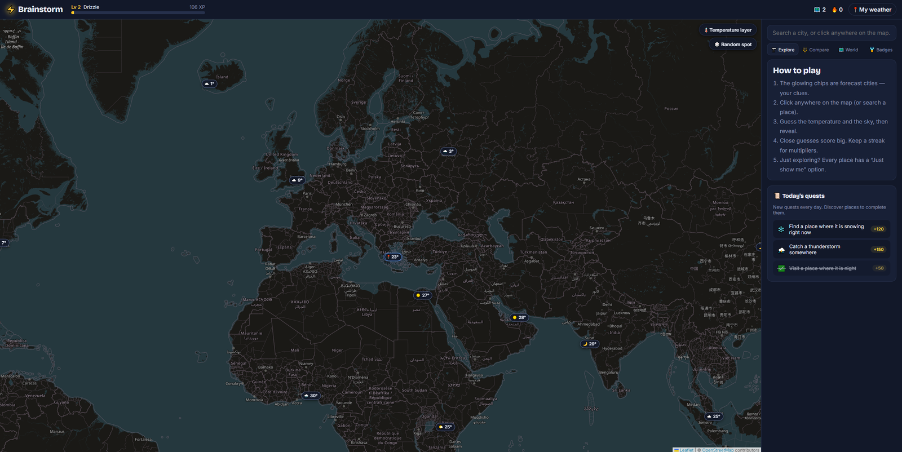

# ⚡ Brainstorm

**▶ Play it live: https://strudast.github.io/brainstorm/**



**Guess the weather anywhere on Earth.** A gamified take on weather exploration: the map shows a handful of "TV forecast" cities as clues, you click anywhere else in the world, guess the temperature and the sky, then reveal the real conditions and score points. Every place you discover becomes part of *your world* — your own picture of the planet's weather, ranked hottest to coldest.

> Work in progress — this is the first playable version.

## How it plays

- **Forecast cities** — 20 cities spread across the globe show live conditions. They're your clues (and the "weather presenter" overview).
- **Discover** — click anywhere on the map or search a place. Before you see anything, guess:
  - the **temperature** (slider, −40 … 50 °C)
  - the **sky** (clear, cloudy, fog, rain, snow, storm)
- **Score** — up to 60 pts for temperature (−6 per degree off) + 40 for the right sky.
- **Streaks** — guesses scoring 60+ build a streak; each step adds +25 % (max ×2).
- **Levels** — XP levels you up from *Light Breeze* to *Brainstorm*.
- **Daily quests** — 3 per day, the same for everyone on a given date (e.g. *find somewhere below freezing*, *find two places 30 °C apart*).
- **Badges** — permanent achievements (*Fire & Ice*, *Full Deck*, *Night Owl*, …).
- **No pressure to play** — every place has *Just show me the weather*: no guess, no points, the place still joins your world.
- **Clue penalty** — guessing right next to a place whose weather you can already see (a forecast city, your location or an earlier discovery) is easy, so points scale down within 800 km of one.
- **Temperature layer** — a TV-style heat map of the whole planet, from a single request, loaded only when switched on.
- **Compare** — put 2–3 places side by side: current conditions, a one-line insight ("Cairo is 27 °C warmer than Reykjavik") and a 7-day high/low chart.
- **Random spot** — jump somewhere unexpected (keyboard-friendly way to play, too).
- **My weather** — one click shows the weather where you are (browser geolocation).
- **Your world** — every discovery, sorted hottest → coldest with a temperature bar.

Progress is saved in `localStorage`.

## 1. Installation & setup

**Prerequisites:** Node.js 20.19+ (or 22.12+) and npm.

```bash
git clone https://github.com/strudast/brainstorm.git
cd brainstorm
npm install
npm run dev        # http://localhost:5173
```

Other scripts: `npm test` (Vitest), `npm run build` (type-check + production build), `npm run preview`, `npm run lint`.

**Deployment:** every push to `main` runs the tests, builds and deploys to GitHub Pages (`.github/workflows/deploy.yml`).

**Environment variables:** none. Open-Meteo's free API needs no key.

## 2. Implementation choices

| | |
|---|---|
| **React 19 + TypeScript + Vite** | Fast dev loop, strict types for API data and game rules. |
| **Leaflet + react-leaflet** | Free, no API key, lightweight. Standard OpenStreetMap tiles, darkened with a CSS filter to fit the theme. |
| **Zustand** (+ `persist`) | Tiny global store for game state, persisted to localStorage with no boilerplate. |
| **Plain CSS** | No UI kit — one stylesheet with CSS variables keeps the look custom and the bundle small. |
| **Hand-rolled SVG chart & canvas heat map** | Two small, specific visuals didn't justify a charting library. |
| **Vitest + jsdom** | Same config as Vite; tests for game rules, the store and the API client/cache. |

**Being mindful of the API limits**

- The 20 overview cities load in **one** multi-location forecast request.
- Forecasts are **cached for 15 minutes** per ~11 km cell (coordinates rounded to 0.1°), in memory and in localStorage, so reloads and revisits are free.
- Identical in-flight requests are **de-duplicated**.
- A new place's weather is fetched **only when you press Reveal** (or *Just show me*), not when you click around.
- The temperature layer (180 grid points) is the most expensive call — Open-Meteo counts each location — so it is **opt-in** and cached for 30 minutes.
- Place search is **debounced** (350 ms), needs 2+ characters, cancels stale requests and caches results.

**Code layout**

```
src/
  api/openMeteo.ts      forecast + geocoding client, caching
  game/rules.ts         scoring, levels, quests, achievements, distances (pure functions)
  game/store.ts         persisted game state + toasts
  lib/                  weather-code mapping, places, helpers
  components/           map, temperature layer, search, place panel (guess → reveal),
                        compare, sidebar, HUD
  **/*.test.ts          Vitest specs
```

## 3. Incomplete requirements

- Map clicks are named by coordinates: Open-Meteo has no reverse geocoding.
- The temperature layer is deliberately coarse (15° × 20° grid, interpolated) to keep it to one request; it does not follow the visible map area.
- No component/E2E tests yet — the tests cover logic, state and the API layer.

## 4. Next steps

- Viewport-aware temperature/precipitation layers (finer grid for the area on screen, rain overlay).
- Component tests (React Testing Library) and a Playwright smoke test against a mocked API.
- Place names for map clicks via a reverse-geocoding service.
- Shareable daily result ("Brainstorm #42 — 🎯🎯🔥 512 XP") and a daily challenge everyone plays on the same spots.
- Fuller keyboard support for placing a guess on the map itself.

## Trade-offs

- **Game vs. exploration.** Guessing first makes discovery memorable, but it can get in the way of someone who just wants the weather. *Just show me*, the always-visible forecast cities, your own location and the compare view keep plain exploration one click away.
- **Clues vs. fairness.** Forecast cities are both the "TV overview" and hints. Instead of hiding them, points shrink near them, which nudges players towards less-known places.
- **Requests vs. richness.** Every visual is built around the free-tier limits: batching, caching, fetching on demand and an opt-in global layer.
- **No backend.** Progress lives in localStorage; nothing to deploy beyond static files, at the cost of no cross-device sync or leaderboards.

## 5. Additional notes

- Weather data: [Open-Meteo](https://open-meteo.com/) (CC BY 4.0). Map data and tiles © OpenStreetMap contributors.
- Accessibility: keyboard focus styles, ARIA roles for the sky picker, `aria-live` reveal, and `prefers-reduced-motion` respected.
- AI tools were used to help build this project.
